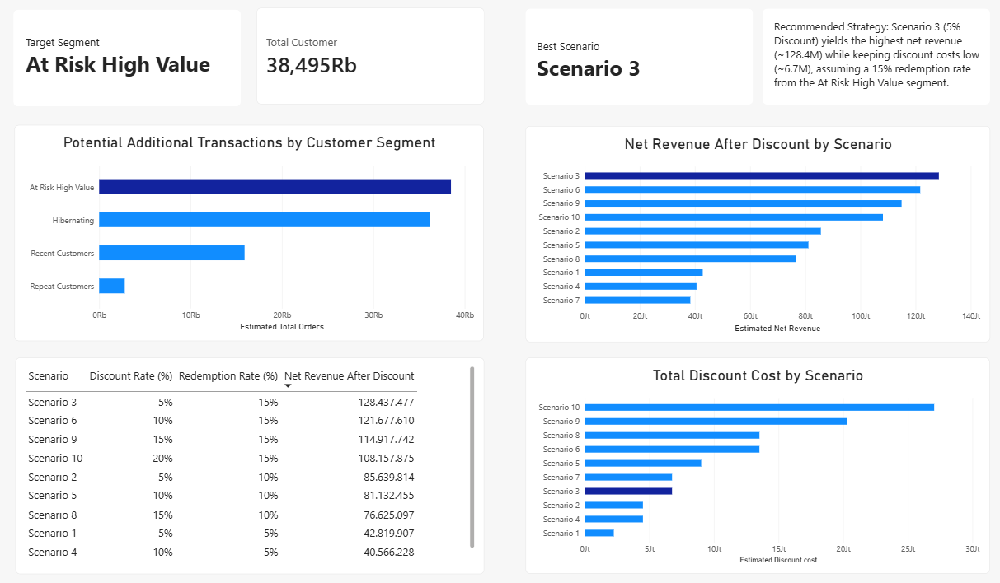

# Olist E-Commerce Customer Segmentation & Retention Strategy

**Analisis Perilaku Pelanggan, Segmentasi RFM, dan Strategi Retensi Menggunakan SQL Server, Python, Excel, dan Power BI.**

---

## Project Overview

Bagaimana bisnis e-commerce mengidentifikasi pelanggan yang berisiko tidak melakukan pembelian kembali dan menentukan strategi untuk mempertahankan mereka?

Proyek ini menggunakan data transaksi Olist Brazilian E-Commerce untuk menganalisis perilaku pembelian pelanggan, membangun segmentasi pelanggan, serta mengidentifikasi peluang peningkatan transaksi melalui simulasi strategi bisnis.

Dengan mengintegrasikan **SQL Server, Python, Excel, dan Power BI**, proyek ini mencakup proses analisis mulai dari pengolahan data hingga penyajian rekomendasi bisnis berbasis data.

## Business Problem

Dalam bisnis e-commerce, setiap pelanggan memiliki karakteristik pembelian yang berbeda. Tanpa segmentasi yang tepat, perusahaan akan kesulitan menentukan pelanggan yang perlu diprioritaskan dalam strategi pemasaran dan retensi.

Proyek ini berfokus pada empat pertanyaan bisnis:

1. Bagaimana mengelompokkan pelanggan berdasarkan perilaku pembelian mereka?
2. Segmen pelanggan mana yang memiliki potensi tambahan transaksi terbesar?
3. Bagaimana mengidentifikasi pelanggan bernilai tinggi yang sudah lama tidak melakukan pembelian?
4. Bagaimana membandingkan skenario diskon untuk mendukung strategi reaktivasi pelanggan?

## Project Objectives

- Menganalisis perilaku pembelian pelanggan menggunakan metode RFM.
- Mengelompokkan pelanggan menggunakan algoritma K-Means Clustering.
- Mengidentifikasi karakteristik dan profil setiap segmen pelanggan.
- Mengukur potensi tambahan transaksi melalui simulasi peningkatan Frequency.
- Membandingkan skenario diskon untuk strategi reaktivasi pelanggan.
- Menyajikan hasil analisis dalam dashboard interaktif Power BI.

## Dataset

**Olist Brazilian E-Commerce Public Dataset**

Dataset menyediakan informasi transaksi e-commerce, pelanggan, pesanan, produk, dan pembayaran dari marketplace Olist di Brasil.

Sumber: [Kaggle — Brazilian E-Commerce Public Dataset by Olist](https://www.kaggle.com/datasets/olistbr/brazilian-ecommerce)

Analisis segmentasi menggunakan data pelanggan yang memiliki transaksi berstatus `delivered`.

## Tools & Technologies

| Tools | Penggunaan |
|---|---|
| SQL Server | Data extraction, data preparation, dan SQL Views |
| Python | Data cleaning, transformation, dan customer segmentation |
| Pandas & NumPy | Data manipulation dan processing |
| Scikit-learn | K-Means Clustering dan model evaluation |
| Excel | What-If Analysis dan business simulation |
| Power BI | Dashboard, data visualization, dan business insights |

---

## Analysis Workflow

### 1. Data Preparation — SQL Server

Melakukan pengolahan data transaksi dengan menggabungkan beberapa tabel utama:

- Orders
- Customers
- Order Items
- Products

Tahapan:

- Memfilter transaksi dengan status `delivered`.
- Menggabungkan data transaksi, pelanggan, dan produk.
- Membuat SQL Views untuk mempermudah ekstraksi data.
- Menghitung metrik Recency, Frequency, dan Monetary pada tingkat pelanggan.

**Source Code:** [Lihat SQL Queries](sql/create_views.sql)

### 2. Data Cleaning & Transformation — Python

Melakukan persiapan data sebelum proses segmentasi.

Tahapan:

- Validasi struktur dan tipe data.
- Penanganan missing values dan duplikasi.
- Menghapus data pembelian yang tidak valid.
- Transformasi logaritmik menggunakan `log1p`.
- Standarisasi fitur menggunakan `StandardScaler`.

**Source Code:**

- [Data Cleaning](python/cleaning/rfm.py)
- [Feature Transformation](python/transform/rfm.py)

### 3. Customer Segmentation — K-Means Clustering

Menerapkan algoritma K-Means untuk mengelompokkan pelanggan berdasarkan tiga metrik RFM:

| Metrik | Definisi |
|---|---|
| Recency | Jarak waktu sejak pembelian terakhir pelanggan |
| Frequency | Jumlah transaksi pelanggan |
| Monetary | Total nilai pembelian produk pelanggan |

Model segmentasi final menggunakan empat cluster dengan hasil evaluasi:

| Evaluasi | Hasil |
|---|---:|
| Jumlah Cluster | 4 |
| Silhouette Score | 0.390878 |

Hasil clustering kemudian dianalisis berdasarkan karakteristik RFM setiap cluster untuk menghasilkan profil segmen pelanggan.

**Source Code:** [Lihat K-Means Analysis](python/analysis/rfm.py)

### 4. Customer Segment Profiling

Analisis menghasilkan empat segmen pelanggan:

| Segmen | Karakteristik |
|---|---|
| At Risk High Value | Pelanggan dengan nilai pembelian relatif tinggi, tetapi sudah lama tidak melakukan pembelian |
| Hibernating | Pelanggan dengan aktivitas pembelian rendah dan periode tidak aktif yang panjang |
| Recent Customers | Pelanggan dengan aktivitas pembelian relatif baru |
| Repeat Customers | Pelanggan dengan frekuensi pembelian relatif lebih tinggi |

Jumlah pelanggan berdasarkan hasil segmentasi final:

| Segmen | Jumlah Pelanggan |
|---|---:|
| At Risk High Value | 38.495 |
| Hibernating | 36.151 |
| Recent Customers | 15.911 |
| Repeat Customers | 2.801 |
| **Total** | **93.358** |

### 5. Business Simulation — Excel

Hasil segmentasi digunakan sebagai dasar untuk menyusun dua simulasi strategi bisnis.

**A. Purchase Frequency Simulation**

Mensimulasikan peningkatan Frequency sebanyak satu transaksi tambahan untuk setiap pelanggan pada masing-masing segmen.

Hasil simulasi digunakan untuk:

- Mengestimasi tambahan transaksi setiap segmen.
- Membandingkan potensi transaksi antarsegmen.
- Mengidentifikasi segmen dengan potensi tambahan transaksi terbesar.

**B. Customer Reactivation Simulation**

Berfokus pada segmen At Risk High Value dengan membandingkan kombinasi besaran diskon dan redemption rate.

Indikator yang dianalisis:

- Estimasi jumlah pelanggan yang merespons.
- Recovered Revenue.
- Biaya diskon.
- Estimasi pendapatan setelah diskon.

**File:** [Lihat Excel Business Simulation](excel/WHAT-IF%20Scenario.xlsx)

### 6. Business Intelligence — Power BI

Membangun dashboard untuk menyajikan hasil segmentasi pelanggan dan simulasi strategi bisnis.

Halaman Business Strategy menampilkan:

- Target segmen pelanggan.
- Potensi tambahan transaksi berdasarkan segmen.
- Perbandingan estimasi pendapatan setelah diskon.
- Perbandingan biaya diskon antar-skenario.
- Business insights dan rekomendasi strategi retensi.

**Dashboard:** [Lihat Power BI Report](powerbi/dashboard.pbix)

---

## Key Findings & Business Insights

### 1. Customer Segmentation

K-Means menghasilkan empat kelompok pelanggan dengan karakteristik perilaku pembelian yang berbeda.

Hasil ini membantu mengidentifikasi pelanggan berdasarkan aktivitas transaksi dan nilai pembeliannya.

### 2. Potential Additional Transactions

Berdasarkan simulasi peningkatan Frequency sebanyak satu transaksi untuk setiap pelanggan, segmen At Risk High Value memiliki estimasi tambahan transaksi terbesar, yaitu **38.495 transaksi**.

Hal ini menunjukkan besarnya potensi volume transaksi dari segmen tersebut apabila strategi pembelian ulang berhasil dijalankan.

### 3. Customer Reactivation Strategy

Dari sepuluh skenario diskon yang diuji, Skenario 3 dengan diskon 5% dan redemption rate 15% menghasilkan estimasi pendapatan setelah diskon tertinggi, yaitu sekitar **Rp128,44 juta**.

Skenario tersebut dapat dipertimbangkan sebagai kandidat awal untuk pengujian strategi reaktivasi pelanggan.

### 4. Business Recommendations

Berdasarkan hasil analisis:

- Memprioritaskan segmen At Risk High Value dalam program reaktivasi pelanggan.
- Mengembangkan strategi pemasaran yang mendorong pembelian ulang.
- Mempertimbangkan Skenario 3 sebagai alternatif awal kampanye diskon.
- Mengevaluasi efektivitas strategi menggunakan data kampanye aktual.

---

## Dashboard Preview



*Dashboard menampilkan simulasi potensi tambahan transaksi dan perbandingan skenario reaktivasi pelanggan.*

---

## Repository Structure

```text
Olist-ECommerce-Customer-Segmentation/
│
├── python/
│   ├── analysis/
│   │   └── rfm.py
│   ├── cleaning/
│   │   └── rfm.py
│   ├── transform/
│   │   └── rfm.py
│   ├── database.py
│   ├── extractor.py
│   ├── main.py
│   └── result_storage.py
│
├── sql/
│   └── create_views.sql
│
├── excel/
│   └── WHAT-IF Scenario.xlsx
│
├── powerbi/
│   └── dashboard.pbix
│
├── images/
│   └── preview.png
│
├── .gitignore
└── README.md
```

## How to Run

### 1. Clone Repository

```bash
git clone https://github.com/GenisGenerik/Olist-E-Commerce-Customer-Segmentation-Retention-Strategy.git
```

### 2. Install Dependencies

```bash
pip install pandas numpy scikit-learn sqlalchemy pyodbc matplotlib
```

### 3. Prepare SQL Server Database

- Buat database `OlistECommerceDB`.
- Import tabel dataset Olist.
- Jalankan file `sql/create_views.sql`.
- Sesuaikan konfigurasi koneksi database pada `python/database.py`.

### 4. Run Python Pipeline

```bash
cd python
python main.py
```

### 5. Open Power BI Dashboard

Buka file `powerbi/dashboard.pbix` menggunakan Power BI Desktop.

---

## Limitations

- Hasil simulasi merupakan estimasi berdasarkan asumsi, bukan hasil kampanye aktual.
- Simulasi peningkatan Frequency mengasumsikan setiap pelanggan melakukan satu transaksi tambahan.
- Simulasi diskon belum memperhitungkan harga pokok produk dan biaya operasional lainnya. Oleh karena itu, pendapatan setelah diskon tidak dapat dianggap sebagai laba bersih.
- Hasil segmentasi merepresentasikan data historis pada dataset yang digunakan.

---

**Project Category:** Data Analytics | Customer Segmentation | Customer Retention | Business Intelligence

**Author:** Genis Generik